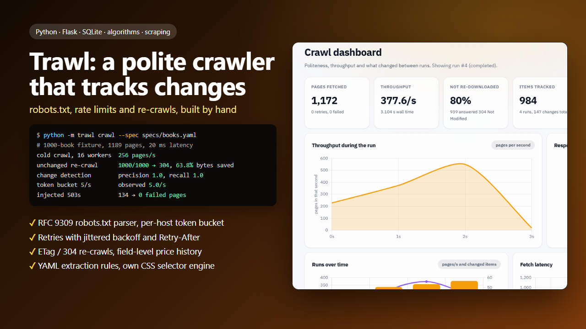
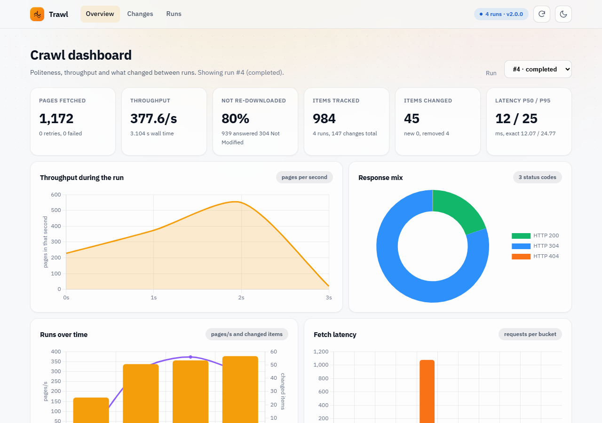
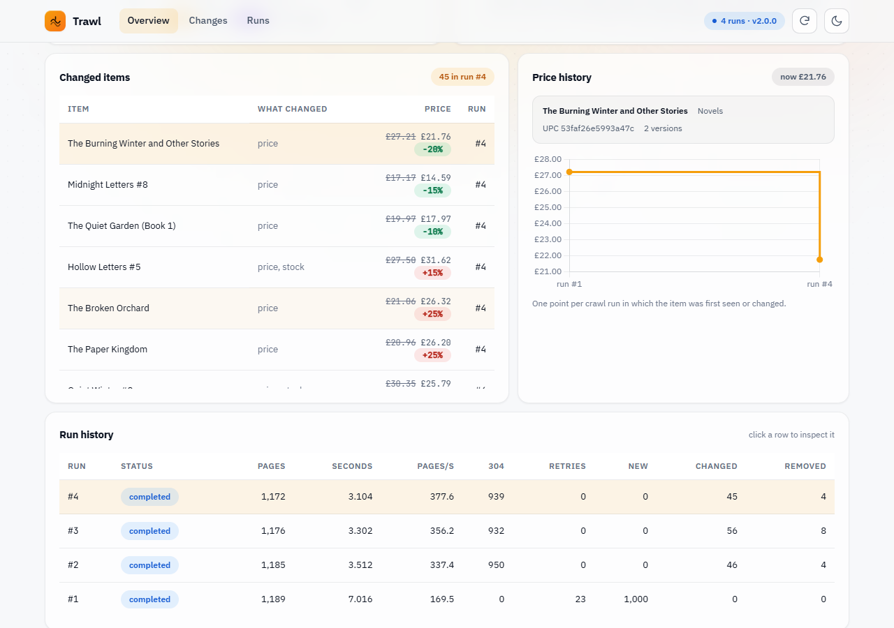
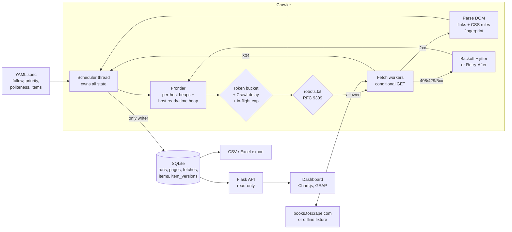

# Trawl: a polite crawler that tracks changes



Trawl is a crawling and scraping framework. It reads a YAML spec that sets which pages to follow, how fast to go and which fields to extract. It crawls with a pool of workers, stays within each host's limits, and saves every run in SQLite. Re-crawls send conditional requests, so unchanged pages come back as `304 Not Modified` and are not downloaded again. Each item is compared field by field with its previous version, giving a price and stock history per product. A Flask dashboard shows throughput, status codes, latency, run history and what changed. CSV and Excel exports cover items, changes and runs.

The demo target is [books.toscrape.com](https://books.toscrape.com), a sandbox site built for scraping practice. A bundled fixture bookstore uses the same URL layout and markup. It can reprice, restock and remove books between versions and reports the exact ground truth, so the tests, the benchmark and the dashboard demo run offline. They also check change detection against known answers, not against a guess.

The parts that are usually imported are written here and tested: a robots.txt parser that follows RFC 9309, a Mercator-style frontier, per-host token buckets, an HTML tree builder and a CSS selector engine. Requests, Scrapy, BeautifulSoup, lxml and `urllib.robotparser` are not used. Runtime dependencies are Flask, PyYAML and openpyxl.

| Overview | Changes and price history |
|---|---|
|  |  |

## Features

**robots.txt, RFC 9309** (`trawl/robots.py`)
- Matches on the product token, case-insensitively. Groups that name the same agent are merged, and `*` is used only when no specific group matches.
- The longest match wins, and allow wins a tie. `*` and `$` wildcards work, and percent-escapes are normalized on both sides. `/robots.txt` is always allowed.
- Status rules from the RFC: a 4xx means allow everything; a 5xx or a network error means disallow everything. Redirects are followed for up to 5 hops.
- `Crawl-delay` is applied per host and can only slow the crawl down. `python -m trawl robots URL` explains any decision.

**Frontier and politeness** (`trawl/frontier.py`, `trawl/ratelimit.py`, `trawl/urls.py`)
- One priority queue per host plus a heap of hosts keyed by when each one may next be contacted. `pop` never returns a URL whose host is cooling down, so one slow host doesn't hold up the others.
- URLs are normalized and deduplicated, following RFC 3986:
  - lowercase host, default port dropped, dot segments resolved
  - tracking parameters removed, remaining query sorted
  
  Each spec sets the priority, so listings can be discovered before product pages.
- Each host gets a token bucket (rate and burst) and a cap on requests in flight.
- 408, 429, 5xx and network errors are retried with exponential backoff and full jitter. `Retry-After` is honoured, in seconds or as an HTTP date. The wait blocks the whole host, not just the one URL.

**Fetching and change detection** (`trawl/fetch.py`, `trawl/crawler.py`)
- Requests use `If-None-Match` and `If-Modified-Since` whenever validators are stored. A `304` reuses the stored links and skips extraction.
- Pages without validators get a SHA-256 fingerprint of their visible text. Selectors listed under `ignore` (such as a footer with a render timestamp) are left out, so a changing timestamp does not count as a change.
- Keep-alive connections per worker, gzip and deflate, and a size cap.
- Redirects are not followed automatically. The crawler checks each target against the allow rules and robots.txt.
- Off-site links, `mailto:`, `rel=nofollow` and robots-disallowed paths are filtered out and counted.
- Items are compared field by field across runs. An item is marked removed only at the end of a run that completed, so a capped or failed run never marks items as removed.

**Extraction rules** (`trawl/spec.py`, `trawl/dom.py`, `trawl/css.py`)
- YAML spec: seeds, user agent, politeness, crawl limits, follow allow and deny regexes, priority patterns, fingerprint ignores, and item rules (URL pattern, key, fields).
- Field options: `css`, `attr`, `regex`, `map`, `type` (`str`, `int`, `float`, `money`, `bool`, `url`), `default`, `required`, and `many` for lists. The spec is validated, and error messages name the exact path, for example `items[0].fields.price`.
- An HTML tree builder that repairs common broken markup, such as implied end tags, void elements and stray closers.
- A CSS selector engine with attribute operators, all four combinators, `:nth-child(an+b)` and the other structural pseudo-classes, `:not()`, and the scraping extension `:contains()`. It matches right to left, the way browsers do.

**Storage, export and dashboard** (`trawl/store.py`, `trawl/export.py`, `trawl/web/`)
- The SQLite tables are:
  - `runs`
  - `pages`: validators, fingerprint, links
  - `fetches`: each request with its status, outcome, latency and bytes
  - `items` and `item_versions`
- CSV export of current items, and an Excel workbook with Items, Changes (old and new value plus % change) and Runs sheets.
- A read-only Flask dashboard:
  - KPIs: pages, pages/s, share answered 304, items, changes, and p50/p95 latency.
  - Charts: throughput per second during the run, the status code mix, runs over time and a latency histogram.
  - A changed-items table with price deltas, a per-item price history, and the run history.
  - Light and dark themes.

**Production touches**
- A single scheduler thread owns every piece of mutable state and is the only one that writes to the database. Workers only fetch and parse, so the engine needs no locks.
- The clock, sleep, fetcher and executor are injected. The crawler tests run a whole crawl deterministically on a fake clock in milliseconds. A separate set of tests runs over real sockets.
- Strict CSP: no inline scripts or styles, and scripts load only from `'self'` and cdnjs. JSON errors for 400 and 404, and a `/health` endpoint.
- Multi-stage Docker image that runs as a non-root user on a read-only root filesystem, served by gunicorn. docker-compose with a named volume for the database.
- GitHub Actions CI:
  - ruff
  - pytest with coverage (at least 85 %) on Python 3.11, 3.12 and 3.13
  - a benchmark smoke run
  - a Docker smoke test that crawls the fixture inside the container and checks the API

## Architecture



## Quickstart

```bash
python -m venv .venv && . .venv/bin/activate      # Windows: .venv\Scripts\activate
pip install -r requirements.txt

python -m trawl demo                              # offline: 4 versions of a 1000-book fixture, 4 runs
python -m trawl serve                             # dashboard on http://127.0.0.1:8000
```

`demo` serves the fixture on a local port and crawls it once per site version. Between versions some books are repriced, restocked or removed, so the dashboard has real changes to show. Each run checks the stored items against the fixture's ground truth.

Crawling the real site (2 requests/s, 4 workers by default, set in `specs/books.yaml`):

```bash
python -m trawl crawl specs/books.yaml --max-pages 200
python -m trawl crawl specs/books.yaml            # run again: product pages come back 304
python -m trawl export items.xlsx                 # or items.csv
python -m trawl runs
python -m trawl robots https://books.toscrape.com/catalogue/page-2.html
```

With Docker:

```bash
docker compose up --build                                         # dashboard on http://localhost:8000
docker compose run --rm trawl python -m trawl demo --db /data/trawl.db
```

Tests, lint and the benchmark:

```bash
pip install -r requirements-dev.txt
python -m pytest -q                 # 121 tests
ruff check .
python scripts/benchmark.py         # writes examples/benchmark.json and examples/benchmark.md
```

## CLI

| Command | What it does |
|---|---|
| `crawl [spec] [--seed URL]... [--max-pages N] [--concurrency N] [--rate R] [--db F]` | Run a spec. `--seed` overrides the spec's seeds, and `--rate 0` turns off rate limiting |
| `demo [--books N] [--versions N] [--latency S]` | Offline demo: crawl the fixture through several site versions |
| `fixture [--port P] [--books N] [--version V] [--latency S] [--crawl-delay S]` | Serve the fake bookstore over HTTP |
| `export OUT.csv\|OUT.xlsx [--spec NAME]` | Export items (the xlsx file also has Changes and Runs sheets) |
| `runs [--limit N]` | List crawl runs with their stats |
| `serve [--host H] [--port P]` | Start the dashboard |
| `robots URL [--user-agent UA]` | Fetch robots.txt and explain whether a URL may be crawled |

## API

| Method | Path | Description |
|---|---|---|
| GET | `/health` | Status, version, number of runs, uptime |
| GET | `/api/summary` | Totals for runs, items, pages, fetches and changes, plus the latest run |
| GET | `/api/runs?limit=` | Run history with stats (pages, seconds, pages/s, status codes, 304s, retries, item counts, latency) |
| GET | `/api/runs/<id>` | One run plus its latency histogram and pages per second over the run |
| GET | `/api/changes?run=&limit=` | Changed items with old and new values per field and the price change in % |
| GET | `/api/items?q=&limit=` | Current items, searchable, with their version counts |
| GET | `/api/items/<spec>/<key>/history` | Every version of one item |
| GET | `/` | The dashboard |

The API is read-only on purpose; see Design decisions.

## Measured performance

These come from `python scripts/benchmark.py` on a Windows 11 laptop (16 logical CPUs, Python 3.12.3). The target is the fixture bookstore with 1000 books (1189 pages including listings), served over real HTTP on 127.0.0.1 with 20 ms of simulated latency per request. The full output is in [`examples/benchmark.md`](examples/benchmark.md) and [`examples/benchmark.json`](examples/benchmark.json).

**Cold crawl throughput.** Rate limiting is off here because the fixture is local; politeness is measured separately below.

| Workers | Seconds | Pages/s | p50 / p95 latency | Items equal ground truth |
|---:|---:|---:|---:|:---:|
| 1 | 29.0 | 41.0 | 21.4 / 22.6 ms | yes |
| 4 | 9.4 | 126.5 | 24.5 / 32.6 ms | yes |
| 8 | 8.23 | 144.5 | 33.0 / 58.5 ms | yes |
| 16 | 4.64 | 256.1 | 40.8 / 64.7 ms | yes |

**Re-crawl and change detection** (16 workers)

| Metric | Result |
|---|---|
| Re-crawl of an unchanged site | all 1000 product pages answered 304, 188 listings unchanged by fingerprint, 0 false changes |
| Bytes on the wire, cold vs. unchanged re-crawl | 1,219,599 vs. 441,392 (63.8 % saved) |
| Re-crawl time, cold vs. unchanged | 4.56 s vs. 2.69 s |
| Changed items after a site update | precision 1.0, recall 1.0 (46 of 46) |
| Removed items | 4 of 4, exact set |

**Politeness**

Gaps are measured between consecutive requests to the same host, both when a request leaves the crawler and when the server receives it.

| Limit | Target gap | Min gap, client | Min gap, server | Observed rate |
|---|---:|---:|---:|---:|
| Token bucket 5/s, 4 workers, 40 requests | 0.2 s | 0.1999 s | 0.1784 s | 5.0/s |
| robots.txt `Crawl-delay: 0.5`, 4 workers | 0.5 s | 0.5001 s | 0.4993 s | 1.999/s |

The client-side gaps hold the limit. The server-side minimum can be lower than the target: arrival time includes thread and socket jitter, so one request that leaves late and the next one that leaves on time arrive closer together. The long-run rate is exact.

**Resilience.** 5 % of URLs answer 503 twice before succeeding. That makes 134 injected errors, 134 retries, 0 failed pages, and every item extracted correctly.

**Hand-written components** (best of 3)

| Operation | Time |
|---|---:|
| Parse a product page into a DOM | 1.845 ms |
| Extract 8 fields with CSS rules | 0.895 ms |
| Extract and normalize all links of a listing page | 2.822 ms |
| robots.txt `can_fetch` against 101 wildcard rules | 342 µs |
| Frontier push or pop (10k URLs, 50 hosts) | 17.6 µs |

**Live check against books.toscrape.com** (not part of the benchmark; run by hand on 2026-11-20)
- A 40-page crawl at the spec's 2 requests/s finished at 1.9 pages/s with 40 responses of 200, 0 retries and 0 failures.
- Two product pages extracted every field correctly: UPC, title, price, rating, stock, category and description.
- Re-crawling the same two pages returned `304` for both, because the site sends `ETag` and `Last-Modified`.
- The site has no robots.txt (HTTP 404), which RFC 9309 treats as "allow everything"; `trawl robots` reports exactly that.

## Design decisions

- **One scheduler thread, many fetch workers.** Workers only fetch, parse and extract, which depend only on the response. The scheduler owns the frontier, the rate limiters, the robots cache and the database connection. So there are no locks, SQLite has exactly one writer, and the tests can replace the thread pool with a serial executor.
- **Time is injected everywhere.** Token buckets take `now` as an argument, and the crawler takes a clock and a sleep function. The politeness tests check exact gaps on a fake clock instead of sleeping. The real clock is `time.perf_counter`: on Windows, `time.monotonic` ticks every 15.6 ms, which made 0.2 s gaps measure as 0.19 s.
- **A Mercator-style frontier, not one FIFO queue.** With per-host queues and a heap of host ready times, the crawler can always ask "what may I fetch now, or how long until I can?". A host that is rate limited or blocked by `Retry-After` never stalls the others.
- **Backoff blocks the host, not just the URL.** A 503 or 429 means the server is overloaded. Retrying a different URL on the same host straight away would ignore that.
- **Conditional requests first, fingerprints second.** Validators are free when the server supports them, which saved 63.8 % of the bytes in the benchmark. Listing pages often have no validators, so a fingerprint of their visible text, minus volatile parts, catches the rest.
- **Removals only after a complete run.** A capped or interrupted run has not seen every page, so it cannot know that an item is gone.
- **Robots.txt written by hand.** `urllib.robotparser` uses the first match instead of the longest, has no wildcards and doesn't merge groups. All three give wrong answers on real robots files.
- **Crawling is CLI-only.** If the dashboard could start crawls of user-supplied URLs, it would be an SSRF proxy. The web app only reads the database.
- **Ground truth instead of eyeballing.** The fixture knows which items it changed, so precision and recall of change detection are measured, not estimated.

## Project layout

```
trawl/
  urls.py        URL normalization (RFC 3986), same-site checks
  robots.py      RFC 9309 parser and matcher
  frontier.py    per-host priority queues, dedup, host ready-time heap
  ratelimit.py   token bucket, backoff with full jitter, Retry-After
  fetch.py       HTTP fetcher (conditional GET, keep-alive, gzip, size cap, no auto-redirects)
  dom.py         forgiving HTML tree builder
  css.py         CSS selector parser and matcher
  spec.py        YAML spec loading, validation, link and field extraction, fingerprints
  crawler.py     scheduler + worker pool, retries, change detection
  store.py       SQLite schema and access
  export.py      CSV and Excel export
  fixture/       offline bookstore with versions, faults and ground truth
  web/           Flask API + dashboard (index.html, app.js, style.css, theme.js)
specs/books.yaml rules for books.toscrape.com (and the fixture)
scripts/         benchmark.py
tests/           121 pytest tests (95 % line coverage)
examples/        benchmark results, cover and dashboard screenshots
```

## Limitations

- No JavaScript rendering. Pages that build their content in the browser need a headless browser in front of the fetcher.
- One process. The frontier lives in memory, so a crawl cannot resume after a crash and cannot be split across machines. The SQLite history does survive.
- Links come only from `<a href>`. Sitemaps from robots.txt are listed by `trawl robots` but not crawled.
- The fetcher uses `http.client`: HTTP/1.1 only, with no HTTP/2 and no proxy support.
- With a small `--max-pages`, the books spec spends its budget on listing pages first, because it ranks discovery ahead of product pages. Use `--seed` with product URLs for a quick look.
- The fixture's latency is simulated. Real-site throughput is set by the politeness limits, not by the crawler.

## License

MIT.
